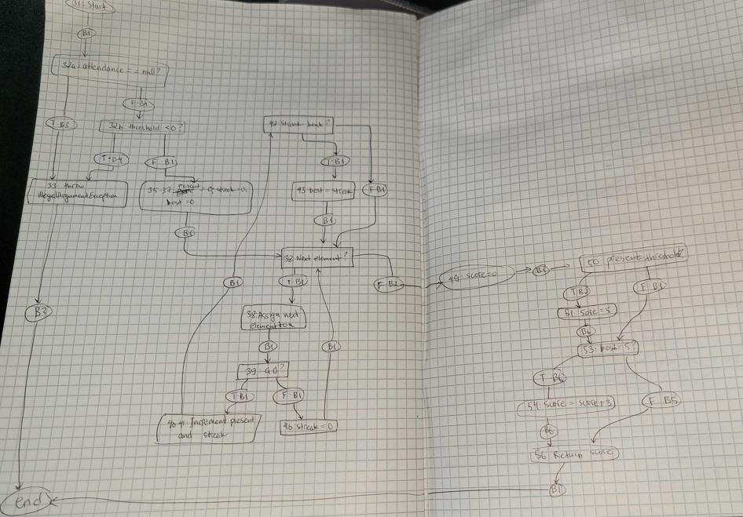

# Лаборатори 10 — Өгөгдлийн урсгалын тест

**Оюутан:** М. Билгүүн-Эрдэнэ  
**Оюутны код:** B222270046

## Хэрэгслийн хувилбар

Windows PowerShell дээр ажиллуулсан командын гаралт:

```text
> java -version
openjdk version "17.0.21.0.2" 2026-10-22 LTS
OpenJDK Runtime Environment Microsoft-15779939 (build 17.0.21.0.2+1-LTS)
OpenJDK 64-Bit Server VM Microsoft-15779939 (build 17.0.21.0.2+1-LTS, mixed mode, sharing)

> mvn -version
Apache Maven 3.10.1 (3afd8084b5629f80b97750906a719879ed4cd283)
Maven home: C:\Users\satan\Downloads\apache-maven-3.10.1-bin\apache-maven-3.10.1
Java version: 17.0.21.0.2, vendor: Microsoft, runtime: C:\Program Files\Microsoft\jdk-17.0.21.21-hotspot
Default locale: en_US, platform encoding: Cp1252, time zone: Asia/Ulaanbaatar
OS name: "windows 11", version: "10.0", arch: "amd64", family: "windows"
```

## A — `gcd`-ийн DU хосууд

Def нь хувьсагчид утга оноох цэг, use нь тэр утгыг унших цэг юм.
Def-clear замд тухайн хувьсагчийн утга use-д хүрэхээс өмнө дахин
оноогдохгүй. `15T` ба `15F` нь `while` нөхцөлийн үнэн ба худал салаа.

| Хувьсагч | Def мөр | Use мөр | Төрөл | Def-clear зам | Тестийн ID | Хамрагдсан |
|---|---:|---|---|---|---|---|
| `x` | 13 | 16 | c-use | 13 → 15T → 16 | G2 | Тийм |
| `x` | 13 | 20 | c-use | 13 → 15F → 20 | G1 | Тийм |
| `x` | 17 | 16 | c-use | 17 → 18 → 15T → 16 | G2 | Тийм |
| `x` | 17 | 20 | c-use | 17 → 18 → 15F → 20 | G2 | Тийм |
| `y` | 13 | 15T | p-use | 13 → 15T → 16 | G2 | Тийм |
| `y` | 13 | 15F | p-use | 13 → 15F → 20 | G1 | Тийм |
| `y` | 13 | 16 | c-use | 13 → 15T → 16 | G2 | Тийм |
| `y` | 13 | 17 | c-use | 13 → 15T → 16 → 17 | G2 | Тийм |
| `y` | 18 | 15T | p-use | 18 → 15T → 16 | G2 | Тийм |
| `y` | 18 | 15F | p-use | 18 → 15F → 20 | G2 | Тийм |
| `y` | 18 | 16 | c-use | 18 → 15T → 16 | G2 | Тийм |
| `y` | 18 | 17 | c-use | 18 → 15T → 16 → 17 | G2 | Тийм |
| `tmp` | 16 | 18 | c-use | 16 → 17 → 18 | G2 | Тийм |

G1: `gcd(7, 0)` давталтад орохгүй, `7` буцаана. Зөвхөн энэ тест
анхны `x` утга 20-р мөрд хүрэх болон анхны `y` утгаар 15F салааг
сонгох хосуудыг хамарна.

G2: `gcd(12, 8)` үед `(12, 8) → (8, 4) → (4, 0)` гэж хоёр
удаа давтаад `4` буцаана. Хоёр дахь давталт нь 17, 18-р мөрд
оноосон утгууд дараагийн давталтын 16, 17-р мөрд хүрэхийг хамарна.

## B — `bonus()`-ийн өгөгдлийн урсгал


T/F нь үнэн/худал салаа. `32a` нь `attendance == null`, `32b` нь `threshold < 0`. B1–B6 нь CFG зурагт, B7 нь `bonus_emptyAttendanceBelowThreshold_returns0` тест юм.

| Хувьсагч | Def | Use | Төрөл | Def-clear зам | Тест |
|---|---:|---|---|---|---|
| `attendance` | 31 | 32a T/F | p | 31 → 32a → 33 / 32b | B3 / B1 |
| `attendance` | 31 | 38 T/F | p | 31 → 32aF → 32bF → 35–37 → 38 → `a` / 49 | B1 / B2 |
| `threshold` | 31 | 32b T/F | p | 31 → 32aF → 32b → 33 / 35 | B4 / B1 |
| `threshold` | 31 | 50 T/F | p | 31 → 32aF → 32bF → 35–37 → 38F → 49 → 50 → 51 / 53 | B2 / B7 |
| `a` | 38 | 39 T/F | p | 38 (оноолт) → 39 → 40 / 46 | B1 / B1 |
| `present` | 35 | 40 | c | 35–37 → 38T → 39T → 40 | B1 |
| `present` | 35 | 50 T/F | p | 35–37 → 38F → 49 → 50 → 51 / 53 | B2 / B7 |
| `present` | 40 | 40 | c | 40 → 41 → 42T → 43 → 38T → 39T → 40 | B1 |
| `present` | 40 | 50 T/F | p | 40 → 41 → 42T → 43 → 38F → 49 → 50 → 51 / 53 | B6 / B1 |
| `streak` | 36 | 41 | c | 36 → 37 → 38T → 39T → 40 → 41 | B1 |
| `streak` | 41 | 41 | c | 41 → 42T → 43 → 38T → 39T → 40 → 41 | B1 |
| `streak` | 41 | 42 T/F | p | 41 → 42 → 43 / 38 | B1 / B1 |
| `streak` | 41 | 43 | c | 41 → 42T → 43 | B1 |
| `streak` | 46 | 41 | c | 46 → 38T → 39T → 40 → 41 | B1 |
| `best` | 37 | 42T | p | 37 → 38T → 39T → 40 → 41 → 42T → 43 | B1 |
| `best` | 37 | 53F | p | 37 → 38F → 49 → 50T → 51 → 53F → 56 | B2 |
| `best` | 43 | 42 T/F | p | 43 → 38T → 39T → 40 → 41 → 42 → 43 / 38 | B6 / B1 |
| `best` | 43 | 53 T/F | p | 43 → 38F → 49 → 50F → 53 → 54 / 56 | B1 / B5 |
| `score` | 49 | 54 | c | 49 → 50F → 53T → 54 | B1 |
| `score` | 49 | 56 | c | 49 → 50F → 53F → 56 | B5, B7 |
| `score` | 51 | 54 | c | 51 → 53T → 54 | B6 |
| `score` | 51 | 56 | c | 51 → 53F → 56 | B2 |
| `score` | 54 | 56 | c | 54 → 56 | B1, B6 |

**Kill:** 46-р мөр өмнөх `streak`-ийг дарна. 36 эсвэл 46-р мөрийн `streak` нь 41-р мөрд уншигдаад шинэчлэгддэг тул хуучин утга 42, 43-р мөрд хүрэхгүй. 51-р мөр ажиллавал 49-р мөрийн `score` дарагдана.

**Биелэхгүй салаа:** `best` 37-р мөрийн `0` утга хэвээр байхад 42-р мөрд анх хүрвэл `streak = 1` тул 42F боломжгүй. Мөн `best = 0` учраас 53T боломжгүй.

| Үе | Тест | Branch | Line |
|---|---:|---:|---:|
| [All-defs](results/jacoco-alldefs.csv) | 4 (2 `gcd`, 2 `bonus`) | 14/16 = 87.5% | 22/24 ≈ 91.67% |
| [Эцсийн](results/jacoco-final.csv) | 9, бүгд тэнцсэн | 16/16 = 100% | 23/24 ≈ 95.83% |

All-defs-д хоёр `bonus` тест хэрэгтэй: B1 нь `score = 0` утгыг 54-р мөрд, B2 нь `score = 5` утгыг 56-р мөрд уншуулна. Нэг гүйцэтгэлд `score = 5` нь анхны `0`-ийг уншихаас өмнө дардаг. Эцсийн тайлангийн хамрагдаагүй нэг мөр нь далд constructor.

## C — Мутацийн үр дүн

| Мутаци | Унасан тест ба үр дүн | Failures / Exit |
|---|---|---:|
| [M1](results/mvn-test-M1.txt) — `streak` шинэчлэлтийг хассан | `bonus_longStreakBelowThreshold_returns3`: `expected: <3> but was: <0>`; `bonus_thresholdMetWithLongStreak_returns8`: `expected: <8> but was: <5>` | 2 / 1 |
| [M2](results/mvn-test-M2.txt) — `best = present` | `bonus_belowThresholdWithShortStreak_returns0`: `expected: <0> but was: <3>` | 1 / 1 |
| [M3](results/mvn-test-M3.txt) — ашиглаагүй `total` нэмсэн | 9 тест бүгд тэнцсэн | 0 / 0 |

M2-д нийт ирц 5 боловч хамгийн урт цуваа 4 тул B5 буруу нэмэгдсэн 3 оноог илрүүлсэн. M3-ын `total`-ийг хаана ч уншдаггүй учраас үр дүн өөрчлөгдөөгүй. Ашиглаагүй хувьсагчийг статик шинжилгээгээр илрүүлж болно. Мутацийн дараа `src/main` нь starter commit `86a0476`-тай ижил байгааг шалгасан.

## Дүгнэлт

Branch хамралт аль салаа ажилласныг харуулдаг. DU шинжилгээ тухайн салаанд ямар оноолтын утга хүрснийг харуулдаг. B7-оос өмнө branch хамралт 100% байсан ч анхны `present = 0` утга 50F-д хүрэх хос дутуу байв. DU хүснэгт гаргахад давталт болон дахин оноолтыг тусад нь шалгах шаардлагатай. M1, M2-ыг тестүүд барьсан. M3 шиг ашиглаагүй утгыг статик шинжилгээгээр шалгах нь тохиромжтой. AI-аас тестийн жишээ, CFG болон тайлангийн найруулгад тусламж авсан. Бас `bonus()`-ийн DU хос бүрийн замыг шалгаж, тохирох тесттэй холбох нь хамгийн их цаг авсан ч AI-ийн ачаар энэ ажлыг хөнгөвчилсөн.